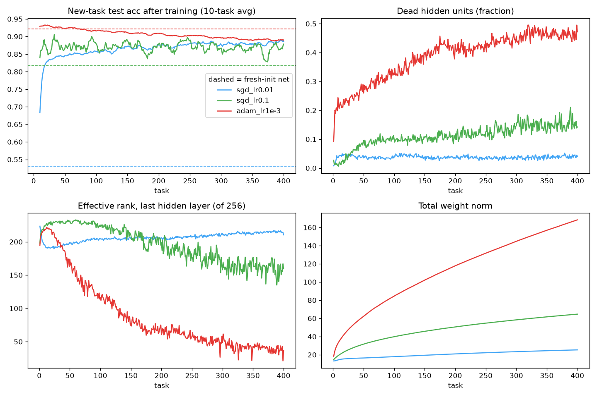

# continual-learning

Small-scale continual-learning (CL) experiments on an Apple Silicon Mac (PyTorch, MPS/CPU). Queue: [QUEUE.md](QUEUE.md).
Setup: `python3 -m venv .venv && .venv/bin/pip install torch torchvision numpy matplotlib`.

## Literature anchors
- Catastrophic forgetting: McCloskey & Cohen 1989; Ratcliff 1990; French 1999 (*Trends Cogn. Sci.*).
- Regularization: EWC (Kirkpatrick et al. 2017, *PNAS*); SI (Zenke, Poole & Ganguli 2017, ICML); LwF (Li & Hoiem 2017, TPAMI).
- Replay/projection: GEM (Lopez-Paz & Ranzato 2017, NeurIPS); A-GEM (Chaudhry et al. 2019, ICLR); "Tiny episodic memories" ER (Chaudhry et al. 2019); iCaRL (Rebuffi et al. 2017).
- Scenarios: van de Ven & Tolias 2019, "Three scenarios for continual learning"; van de Ven, Tuytelaars & Tolias 2022 (*Nat. Mach. Intell.*).
- Loss of plasticity: Dohare et al. 2024, *Nature* 632 (continual backprop); Ash & Adams 2020, shrink-and-perturb (NeurIPS); Lyle et al. 2023, "Understanding plasticity in neural networks" (ICML); Sokar et al. 2023, dormant neurons (ICML); Kumar et al. 2023, "Maintaining plasticity via regenerative regularization" (L2-Init).
- LLM forgetting: Luo et al. 2023, "An empirical study of catastrophic forgetting in LLMs during continual fine-tuning" (arXiv:2308.08747); Biderman et al. 2024, "LoRA learns less and forgets less" (TMLR); Ibrahim et al. 2024, "Simple and scalable strategies to continually pre-train LLMs" (arXiv:2403.08763).
- 2025–26: Zheng et al. 2025, "Spurious forgetting in continual learning of LMs" (arXiv:2501.13453, ICLR 2025); "Spectral collapse drives loss of plasticity" (arXiv:2509.22335); GeRe general-sample replay (arXiv:2508.04676); GORP (ACL 2025); CLoRA (ACL 2025); "Forgetting, plasticity, and co-observation" (arXiv:2608.18803); Ren, Deng, Hong, Lyle & Gal, "Learning dynamics of continual learning" (arXiv:2609.33620); OSW (arXiv:2601.18255).

## Experiment log

### 01 — Permuted-MNIST baseline: naive vs EWC vs replay, plus plasticity probe (2026-10-15)
- **Hypothesis:** naive sequential SGD forgets heavily; small replay (1k buffer) beats EWC at equal effort; over only 10 tasks there is *no* measurable loss of plasticity (Dohare et al. see it over hundreds or thousands of tasks).
- **Method:** 10 permuted-MNIST tasks (task 1 = identity), MLP 784-256-256-10, SGD lr 0.05, batch 128, 1 epoch per task. EWC: diag empirical Fisher (1k samples), λ=50, untuned. Replay: 100 samples per task into a buffer (≤1k), one replay batch per step. "fresh" = new random init per task (plasticity reference). 2 seeds, CPU, 55 s total. `experiments/01_permuted_mnist/`.
- **Result (mean ± sd over 2 seeds):**

  | method | final avg acc (10 tasks) | avg forgetting | task-1 acc at end |
  |---|---|---|---|
  | naive | 0.722 ± 0.010 | 0.223 ± 0.011 | 0.551 |
  | EWC λ=50 | 0.750 ± 0.014 | 0.186 ± 0.016 | 0.666 |
  | replay 1k | **0.873 ± 0.002** | **0.062** | 0.777 |

  Plasticity: accuracy on each new task after learning it *rises* from 0.895 (task 1) to 0.937 (task 10) for naive, against a flat 0.89 for fresh init. That is positive forward transfer, not plasticity loss.
- **Interpretation:** forgetting and the large replay advantage reproduce the standard picture. EWC helps only modestly here, but λ wasn't tuned, so this isn't a fair EWC verdict. As expected, there's no plasticity loss at this horizon; the queue's plasticity experiments need long task streams.

### 02 — Loss of plasticity over a 400-task permuted-MNIST stream (2026-10-16)
- **Hypothesis:** over a long stream, new-task accuracy degrades with plain SGD/Adam, alongside more dead ReLUs, falling effective rank and growing weights (Dohare et al. 2024). Adam should be worse than SGD.
- **Method:** MLP 784-256-256-10 (ReLU). Each task = a new random pixel permutation of a new random 5k-image train subset; 3 epochs, batch 64; evaluated on 2k permuted test images right after training. 400 tasks, no resets. Optimizers: SGD lr 0.01, SGD lr 0.1, Adam lr 1e-3 (default betas). Per task: test acc, dead-unit fraction (units never active on the 2k probe), effective rank (srank, δ=0.01, Kumar et al. 2021) of the last hidden layer, weight norm. Reference = fresh-init net trained the same way (10 tasks). 2 seeds, CPU (faster than MPS for a model this small), 280 s total. `experiments/02_plasticity_stream/` (`run.py 400`, then `analyze.py`).
- **Result (mean of 2 seeds; per-seed values agree within ~0.01 unless noted):**

  | optimizer | new-task acc, tasks 1–50 | tasks 301–400 | fresh-init ref | dead units, first 10 → last 20 | srank, first 10 → last 20 | weight norm, start → end |
  |---|---|---|---|---|---|---|
  | SGD 0.01 | 0.807 | 0.881 | 0.531 | 2.8% → 4.0% | 204 → 215 | 13 → 25 |
  | SGD 0.1 | 0.869 | 0.865 | 0.818 | 1.4% → 15.5% | 217 → 158 | 15 → 65 |
  | Adam 1e-3 | 0.928 | 0.892 | 0.921 | 19% → 46% | 213 → 37 | 18 → 168 |

  
- **Interpretation:** Adam shows clear, monotone plasticity loss: new-task accuracy falls in every 100-task window (0.928 → 0.892 in both seeds) and ends ~3 points *below* a freshly initialized Adam net, while dead units climb to ~46%, effective rank collapses ~6×, and weights grow ~9×. SGD lr 0.1 shows the same correlates in milder form (dead units 15%, srank −27%, weights 4×) but **no measurable accuracy loss yet** (noisy, flat around 0.86–0.89). SGD lr 0.01 shows **no plasticity loss at all** in 400 tasks: it keeps improving (forward transfer) and its representation stays healthy. Caveats: the fresh-init SGD 0.01 reference is badly under-trained in this budget (3 epochs on 5k images), so "above fresh" there mostly reflects a small budget; 2 seeds; one width; a fixed per-task update budget (which Lewandowski et al. note can itself look like plasticity loss).
- **The hypothesis held for Adam, held only in the correlates (not accuracy) for SGD 0.1, and failed for SGD 0.01 at this horizon.** The striking gap between representation collapse (srank 213 → 37) and the modest accuracy drop (~4 points) suggests that these correlates are not tight predictors of plasticity at this scale.
- **Novelty: Known.** Adam's fast collapse in dead units and effective rank, slower SGD loss, and weight growth on Online Permuted MNIST are all reported by Dohare et al. 2024 (*Nature* 632, Extended Data Figs. 3–4). Lyle et al. 2023 (ICML, arXiv:2303.01486) attribute Adam's instability to stale moment estimates after a task switch and show that no single metric (dead units, rank, weight norm) consistently explains plasticity loss, which covers the rank/accuracy decoupling seen here. srank: Kumar et al. 2021 (ICLR, "Implicit under-parameterization"). Step-size dependence: Berariu et al. 2021 (arXiv:2106.00042); Lewandowski et al. 2023 (arXiv:2312.00246).
